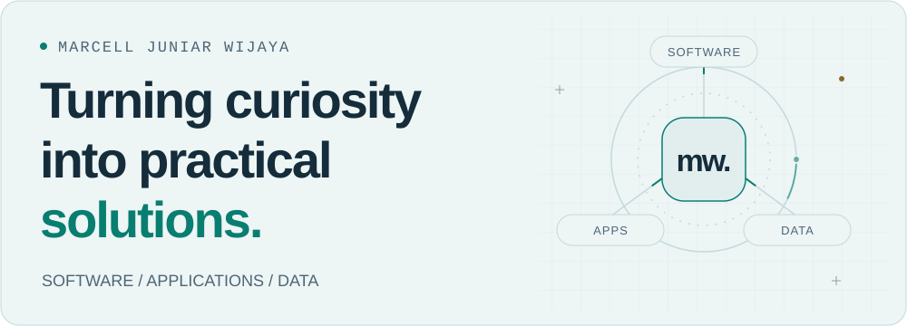

<picture>
  <source media="(prefers-reduced-motion: reduce) and (prefers-color-scheme: dark)" srcset="assets/header-dark-static.svg">
  <source media="(prefers-reduced-motion: reduce)" srcset="assets/header-light-static.svg">
  <source media="(prefers-color-scheme: dark)" srcset="assets/header-dark.svg">
  
</picture>

# Marcell Juniar Wijaya

**Informatics student · Software, applications & data** 
Universitas Esa Unggul · Bekasi, Indonesia

I enjoy understanding how things work and turning that understanding into useful software. My projects explore application logic, relational databases, everyday workflows, and mobile interfaces. I am building a versatile technical foundation, with interests across software engineering, application development, data, and IT problem-solving.

**[LinkedIn](https://www.linkedin.com/in/marcell-wijaya/)** &nbsp; / &nbsp; **[Email](mailto:marcelljuniar5@gmail.com)** &nbsp; / &nbsp; **[Portfolio](https://marwij505.github.io/)** &nbsp; / &nbsp; **[Repositories](https://github.com/Marwij505?tab=repositories)**

---

## A foundation that connects disciplines

- **Software & systems** — Exploring application structure, authentication, access control, and the logic behind useful tools.
- **Data & workflows** — Working with MySQL, relational data, and CRUD operations to support practical business and education use cases.
- **Applications & interfaces** — Building experience with Flask and Laravel applications, alongside Flutter and Dart coursework.

## Selected work

A selection of academic and personal projects, each exploring a different part of building software.

<table>
  <tr>
    <td width="50%" valign="top">
      <h3>01 · Bakery Store</h3>
      
<strong>Business operations & relational data</strong>

      
A store management application with product management, authentication, and owner, manager, and administrator roles.

      
<code>Python</code> <code>Flask</code> <code>MySQL</code>

      
<a href="https://github.com/Marwij505/bakery_store"><strong>Explore the project ↗</strong></a>

    </td>
    <td width="50%" valign="top">
      <h3>02 · Compass Campus</h3>
      
<strong>Information systems & user support</strong>

      
An education help desk for exploring campuses, study programs, and educational guidance. Currently in development.

      
<code>Python</code> <code>Flask</code> <code>MySQL</code>

      
<a href="https://github.com/Marwij505/help_desk"><strong>Explore the project ↗</strong></a>

    </td>
  </tr>
  <tr>
    <td width="50%" valign="top">
      <h3>03 · Flowlist</h3>
      
<strong>Task workflows & application structure</strong>

      
A Laravel task management project with task CRUD, calendar views, statistics, and user profiles.

      
<code>PHP</code> <code>Laravel</code> <code>MySQL</code>

      
<a href="https://github.com/Marwij505/task_management_laravel"><strong>Explore the project ↗</strong></a>

    </td>
    <td width="50%" valign="top">
      <h3>04 · Mobile Lab</h3>
      
<strong>Mobile interfaces & reusable widgets</strong>

      
Mobile programming coursework exploring Flutter layouts, profile cards, themes, and reusable interface components.

      
<code>Dart</code> <code>Flutter</code>

      
<a href="https://github.com/Marwij505/marcell-wijaya_kelompok-5_kh002"><strong>Explore the coursework ↗</strong></a>

    </td>
  </tr>
</table>

## Tools I work with

**Languages** &nbsp; Python · PHP · JavaScript · Dart · SQL 
**Frameworks** &nbsp; Flask · Laravel · Flutter 
**Foundations & tools** &nbsp; MySQL · HTML · CSS · Git · GitHub · VS Code

  
<strong>Where I am growing next</strong>

I am interested in strengthening my skills in software design, testing, data analysis, automation, and the connections between applications and the systems they run on. I value opportunities to learn across technical disciplines and contribute to a team's practical needs.

---

### Let's build something useful.

I welcome conversations about projects, collaboration, and opportunities to learn and contribute across software, applications, data, and IT.

**[Get in touch →](mailto:marcelljuniar5@gmail.com)**

Curious about the problem. Thoughtful about the solution. Always learning.
